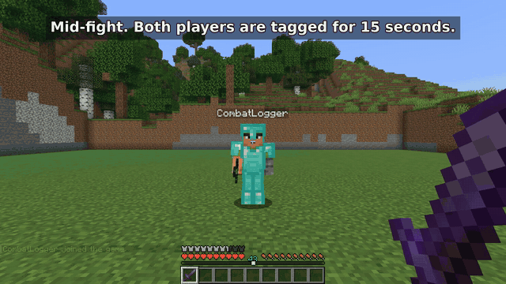
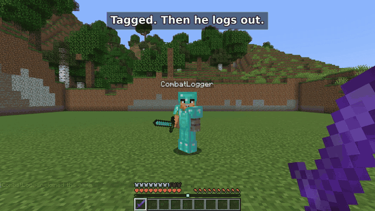
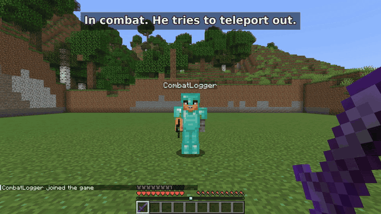

# Combat Persistence

Someone is losing a fight, so they quit the game. On most servers that's the end of it: they're safe and they keep their stuff.

Not with this mod. If a player leaves while they're in combat, a copy of them stays behind for the rest of the combat timer, wearing their gear. Kill it and their items drop. When they log back in, they're dead.

It runs on the server only. Your players don't need to install anything.

For Fabric survival and PvP servers. [See available Minecraft versions](https://modrinth.com/mod/combat-persistence/versions).

## How it works

- Hitting another player puts you both in combat for 15 seconds. The countdown shows above the hotbar. You can change the length in the config.
- If you log out during combat, an `[OFFLINE]` mannequin with your gear stays where you were standing.
- If someone kills the mannequin, your items drop and you die the next time you join.
- If nobody kills it before the timer runs out, it disappears and you get everything back when you log in.
- Only PvP starts the timer. Mobs, fall damage and lava don't. Losing connection counts the same as quitting.

Here's the second case, where nobody kills the mannequin:

## No teleporting out of a fight

While a player is in combat, `/spawn`, `/home`, `/tp`, `/tpa`, `/warp` and `/back` are blocked. You can add your own commands to the list.

## Installing

1. You need a Fabric server on Minecraft 26.3, with Fabric Loader 0.20.1 or newer and Java 25.
2. Drop Combat Persistence and [Fabric API](https://modrinth.com/mod/fabric-api/versions?g=26.3) into the `mods` folder.
3. Start the server once. The config is created at `config/combatpersistence.json`.

On an older Minecraft version? Check the [Versions](https://modrinth.com/mod/combat-persistence/versions) tab. Each file only works on the versions listed for it.

## Settings most people change

| Setting | Default | What it does |
| --- | --- | --- |
| `combatTagDurationSeconds` | `15` | How long combat lasts after the last hit. |
| `blockedCommands` | `/spawn`, `/home`, `/tp`, `/tpa`, `/warp`, `/back` | Commands you can't use in combat. Add aliases your server uses. |
| `combatMessage` | `IN COMBAT: %s s remaining` | The countdown text. |
| `npcNamePrefix` | `[OFFLINE]` | Shown before the mannequin's name. |
| `npcDeathBroadcast` | `[PvP] %s combat logged and was slain!` | Chat message when a mannequin dies. |
| `disableEnderChests` | `false` | Turns off ender chests for the whole server. |

The [full config list](https://github.com/adamhrnciar/combat-persistance#configuration) is on GitHub.

## Offline-mode servers

If your server runs in offline mode, there's an optional login system built in: `/register` and `/login`, hashed passwords, a lockout after too many wrong attempts and a login timeout. Online-mode servers skip all of this because Mojang already checks accounts.

One warning: offline mode doesn't encrypt traffic, so passwords can be read by anyone who can see the connection. Use online mode if you can, and tell players not to reuse real passwords.

## Questions

**Do players need the mod?** No, only the server does.

**Does it work on Paper, Spigot, Forge or NeoForge?** No, it's Fabric only.

**What happens if the server restarts while a mannequin is standing there?** The mannequin is gone, but the inventory is saved to disk, so the player gets it back the next time they join.

**Does it work with other mods?** Vanilla inventories, armor and the offhand are covered. I haven't tested mods that add their own inventory slots (backpacks, trinkets), so try it on a test world first.

**Anything it can't handle?** If the server crashes right after a mannequin dies, before the world saves, the dropped items can be lost. More detail is in the [security notes](https://github.com/adamhrnciar/combat-persistance/blob/main/SECURITY_REVIEW.md).

## Bugs and support

Found a bug? [Open an issue](https://github.com/adamhrnciar/combat-persistance/issues) with your Minecraft version, mod version and server log, and I'll take a look. Remove passwords and IP addresses from the log first.

If this saves your server some drama, following the project here helps, and so does a coffee on [Ko-fi](https://ko-fi.com/pottersgame).

Need a different Minecraft version or loader? [Tell me what your server uses](https://github.com/adamhrnciar/combat-persistance/issues/new?template=compatibility_request.yml). Requests help decide which ports are worth maintaining; they don't promise a release.

## Custom work for your server

Want a different combat rule, command restriction, or integration with another mod? [Ask about paid customization](https://github.com/adamhrnciar/combat-persistance/issues/new?template=custom_work.yml).

Describe what you need and which Minecraft version and mods your server uses. I'll check feasibility before agreeing on scope, price, or a delivery date. An inquiry does not commit either of us to paid work.

Combat Persistence stays free. Bug reports and ordinary feature requests don't require payment.
