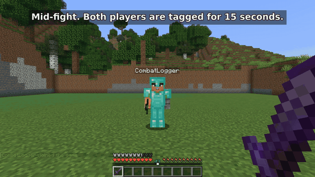
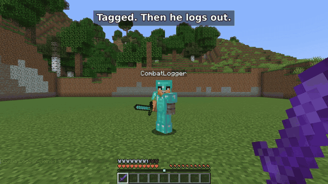
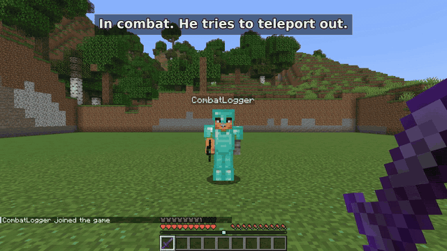

# Combat Persistence

A server-side Fabric mod that stops combat logging. If a player quits in the middle of a fight, a copy of them stays behind with their gear until the combat timer runs out. Kill it and their items drop. When they log back in, they're dead.

Players don't need to install anything. It only goes on the server.

[Download on Modrinth](https://modrinth.com/mod/combat-persistence/versions) · [Config](#configuration) · [Report a bug](https://github.com/adamhrnciar/combat-persistance/issues) · [Custom work](#custom-work)

Current release: 1.10.0 for Minecraft 26.3 (Fabric Loader 0.20.1+, Java 25+, needs Fabric API).

## How it works

1. Hitting another player puts you both in combat for 15 seconds (configurable). The countdown shows above the hotbar.
2. If you log out during combat, an `[OFFLINE]` mannequin with your gear stays where you were.
3. If someone kills it, your items drop and you die the next time you join.
4. If nobody kills it before the timer runs out, it disappears and you get everything back when you log in.

Only PvP starts the timer. Mobs and environmental damage don't. Losing connection counts the same as quitting.

| Nobody kills the mannequin | Escape commands are blocked |
| --- | --- |
|  |  |

## Installing

1. Run a Minecraft 26.3 Fabric server with Fabric Loader 0.20.1 or newer and Java 25.
2. Put the mod and [Fabric API for 26.3](https://modrinth.com/mod/fabric-api/versions?g=26.3) in the `mods` folder.
3. Start the server once and edit `config/combatpersistence.json` if you want to change anything.

For older Minecraft versions, use the version list on [Modrinth](https://modrinth.com/mod/combat-persistence/versions). Each file only supports the versions listed for it.

## What else it does

- Blocks `/spawn`, `/home`, `/tp`, `/tpa`, `/warp` and `/back` during combat. Add your own commands or aliases to the list.
- Saves the inventory to disk when someone combat logs, so a restart or chunk unload doesn't eat their items.
- Can turn off ender chests server-wide if you run an arena.
- Has an optional `/register` and `/login` system for offline-mode servers. Online-mode players never see it.

The mannequin itself isn't saved with the world, so a restart ends the fight. The inventory is still restored on the next join.

## Questions

**Do players need the mod?** No, only the server.

**Is this a Paper, Spigot, Forge or NeoForge plugin?** No. It's a Fabric mod and goes in the `mods` folder.

**Older Minecraft versions?** Check the [Modrinth version list](https://modrinth.com/mod/combat-persistence/versions) and only use a file marked for your version.

**Does it work with other mods?** Vanilla inventories are covered. Mods with their own inventory slots, custom commands or auth proxies haven't been tested, so try it on a test world first.

## Configuration

The configuration file is located at `config/combatpersistence.json`.

### Combat Settings
| Setting | Default | Description |
| :--- | :--- | :--- |
| `combatTagDurationSeconds` | 15 | Duration of the combat tag in seconds. |
| `npcNamePrefix` | `§7[OFFLINE] §f` | The prefix applied to the NPC's name tag. |
| `playSpawnSound` | `true` | Plays a thunder sound when an NPC spawns. |
| `combatMessage` | `§c§lIN COMBAT: §f%s s remaining` | The action bar message shown to tagged players. Use `%s` for time remaining. |
| `npcDeathBroadcast` | `§c[PvP] §7%s combat logged and was slain!` | The message broadcast when an NPC is killed. |
| `debugLogging` | `false` | Extra INFO logging for snapshots, restores and mannequins. Useful when debugging a live server. Errors are always logged. |
| `inventoryRestoredMessage` | `§aYour inventory has been restored.` | Message sent when a player's inventory is restored. |
| `blockedCommands` | `[...]` | List of commands disabled during combat (e.g., /spawn, /home). Namespaced forms like `/minecraft:tp` are blocked automatically; command *aliases* (e.g. `/teleport` for `/tp`) need their own entry. |
| `commandBlockedInCombatMessage` | `§cYou cannot use this command while in combat!` | Message shown when a blocked command is used in combat. |

### Arena / SMP Settings
| Setting | Default | Description |
| :--- | :--- | :--- |
| `disableEnderChests` | `false` | Blocks ender chest use server-wide (via mixin). |
| `enderChestDisabledMessage` | `§cEnder chests are disabled on this server.` | Message shown when a blocked ender chest is opened. |

### Authentication Settings
| Setting | Default | Description |
| :--- | :--- | :--- |
| `enableAuth` | `true` | Turns on the built-in login system. It only applies to offline-mode servers. On online-mode servers Mojang already verifies accounts, so nobody is asked to register. |
| `forceAuthInOfflineMode` | `true` | Requires authentication when the server is in offline mode. Set to `false` to opt an offline-mode server out of password auth entirely. |
| `enableIpAutoLogin` | `false` | Optional IP-based autologin. Off by default (weak behind shared NAT/proxies). |
| `sessionDurationHours` | 24 | How long an autologin session lasts for standard players. |
| `maxLoginAttempts` | 5 | Failed `/login` attempts before lockout (tracked per account and per source IP). |
| `loginLockoutSeconds` | 300 | Lockout duration after too many failed attempts. While locked out, the player is refused at join. |
| `kickOnWrongPassword` | `true` | Kick the player immediately on a wrong `/login` password. |
| `minPasswordLength` | 8 | Minimum password length accepted by `/register`. |
| `maxPasswordLength` | 64 | Maximum password length (BCrypt truncates beyond 72 bytes, so long passwords are refused rather than silently cut). |
| `enableSkinLookups` | `false` | Opt in to external Mojang skin requests. Requests disclose the server IP and requested name/UUID. |
| `skinCommandCooldownSeconds` | 30 | Cooldown between `/skin` uses, protecting the server's shared Mojang API rate limit. |
| `hideInventoryBeforeAuth` | `true` | Conceals the player's inventory until they log in. |
| `hideCoordinatesBeforeAuth`| `true` | Conceals the player's location from unauthenticated users. |
| `authTimeoutSeconds` | 60 | Time in seconds before an unauthenticated player is kicked. |
| `loginTimeoutMessage` | `§cLogin timeout!` | Kick message when authentication times out. |
| `registerPrompt` | `§6Please register using /register <password> <confirmPassword>` | Message prompting for registration. |
| `loginPrompt` | `§6Please log in using /login <password>` | Message prompting for login. |
| `registerSuccess` | `§aSuccessfully registered and logged in!` | Message sent upon successful registration. |
| `loginSuccess` | `§aSuccessfully logged in!` | Message sent upon successful login. |
| `alreadyLoggedIn` | `§cYou are already logged in!` | Error message when already logged in. |
| `alreadyRegistered` | `§cYou are already registered!` | Error message when already registered. |
| `passwordMismatch` | `§cPasswords do not match!` | Error message for password mismatch. |
| `incorrectPassword` | `§cIncorrect password!` | Error message for incorrect password. |
| `authRequiredForCommand` | `§cYou must log in to use commands!` | Error message when using commands without auth. |
| `authRequiredForChat` | `§cYou must log in to chat!` | Error message when chatting without auth. |
| `authRequiredForSkin` | `§cYou must log in to change your skin!` | Error message when changing skins without auth. |
| `skinAppliedMessage` | `§aApplied skin: %s` | Message confirming skin application. |
| `lobbyDimension` | `minecraft:overworld` | The dimension where unauthenticated players are held. |
| `lobbyX, lobbyY, lobbyZ` | `0, 1000, 0` | The coordinates for the authentication lobby. |

## Commands

*   **/register <password> <confirmPassword>**: Register your account.
*   **/login <password>**: Login to your account.
*   **/skin <name>**: Change your skin using a Mojang account name.
*   **/authreset <player>**: *(Operator only)* Reset a player's account so they must register again.

## Security

A few things are worth knowing before you put this on a public server.

**Offline mode.** Offline mode doesn't encrypt traffic, so `/register` and `/login` passwords can be read by anyone who can see the connection. Hashing only protects the stored passwords. Use online mode for public servers if you can, or put the server behind an encrypted tunnel. Players shouldn't reuse real passwords.

**Recommended settings.** Keep `enableIpAutoLogin=false`, `hideInventoryBeforeAuth=true` and `hideCoordinatesBeforeAuth=true`. In offline mode, the first person to register a name owns it, so whitelist your existing players and have them register before you open the server. Lockouts can lock out the real owner for a while, and a restart resets the attempt counters.

**Skins.** Custom skin lookups are off by default. Turning on `enableSkinLookups` sends the requested name or UUID and your server's IP to Mojang.

**Backups.** Back up the world together with `config/auth_data.json`, `pending_locations.json`, `pending_inventories.json` and `combat_persistence_data.json`. They contain password hashes, inventories and coordinates, so keep the backups private. If one of these files can't be read, the server refuses to start instead of quietly treating everyone as unregistered.

**Known limits.** If the server crashes right after a mannequin dies or an overflow snapshot is used, the items can be lost before the world saves. The mod is built to avoid giving items out twice, but there's no single transaction across player files, recovery files and chunks. It also guards against duplicate logins, crafting-grid and cursor dupes, and the signed-command bypass. See [SECURITY_REVIEW.md](SECURITY_REVIEW.md) for what was tested.

## Support

Bug reports go in [GitHub Issues](https://github.com/adamhrnciar/combat-persistance/issues). Include your Minecraft, Fabric Loader and mod versions, your other mods, and how to reproduce it. Remove passwords, IP addresses and player data from logs first.

If the mod is useful to you, a follow on [Modrinth](https://modrinth.com/mod/combat-persistence) or a coffee on [Ko-fi](https://ko-fi.com/pottersgame) is appreciated.

Need a different Minecraft version or loader? [Tell me what your server uses](https://github.com/adamhrnciar/combat-persistance/issues/new?template=compatibility_request.yml). This helps decide which ports are worth maintaining; it doesn't promise a release.

## Custom work

Need Combat Persistence adjusted for your server? [Ask about paid customization](https://github.com/adamhrnciar/combat-persistance/issues/new?template=custom_work.yml), such as a combat rule, command restriction, or integration with another mod.

Describe the change, your server version, and the mods involved. I'll review whether it is feasible before agreeing on scope, price, or a delivery date. An inquiry does not commit either of us to paid work.

The mod stays free. Bug reports and ordinary feature requests are welcome without payment.

## License

GPL-3.0.
